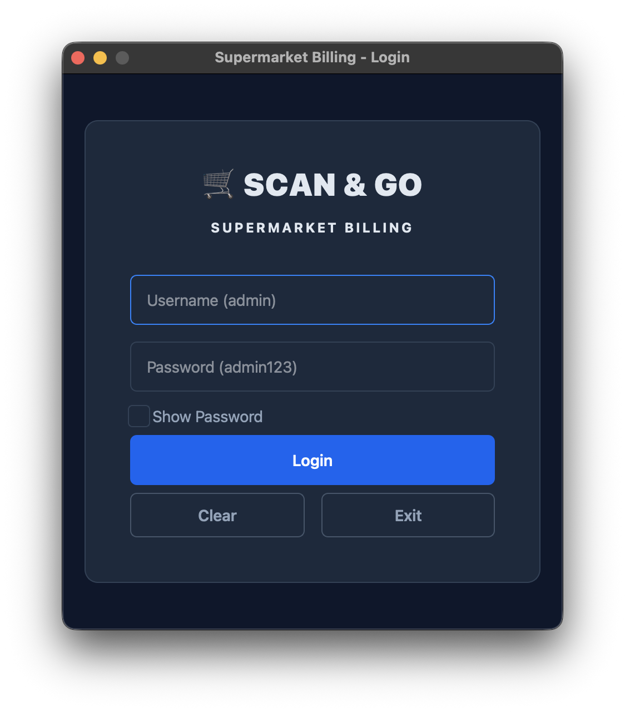
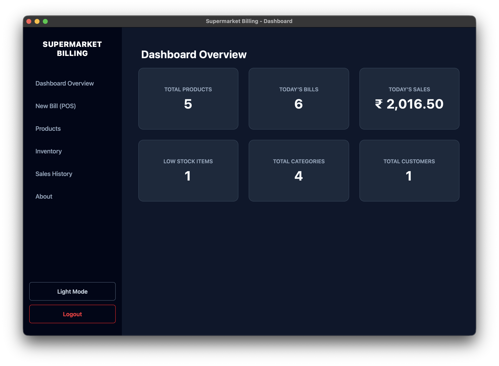
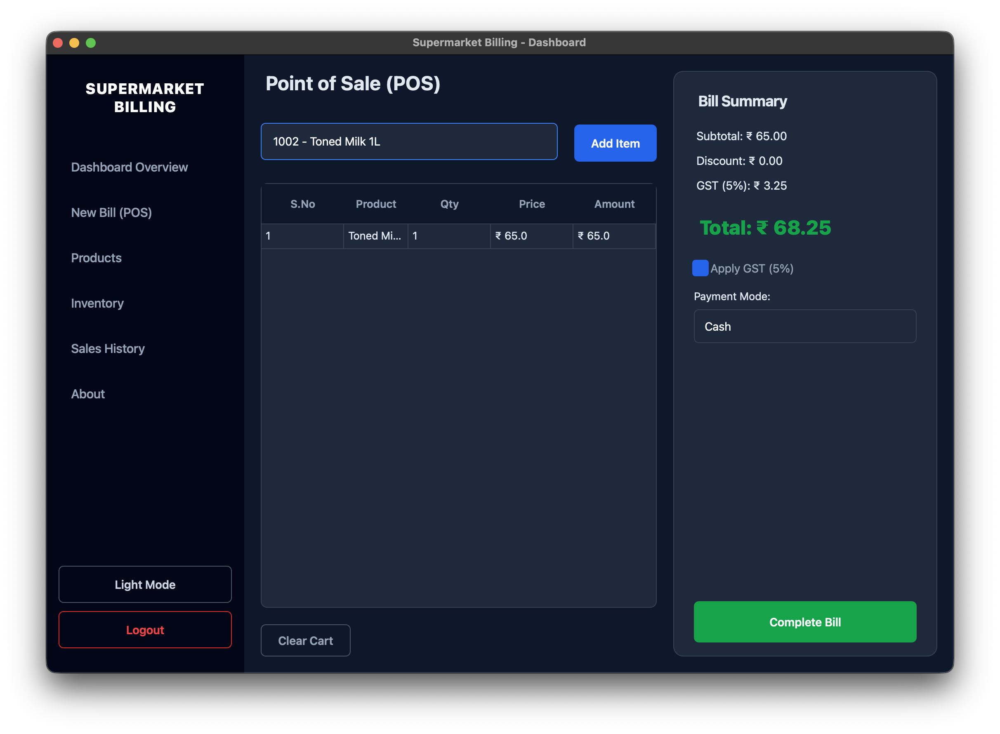
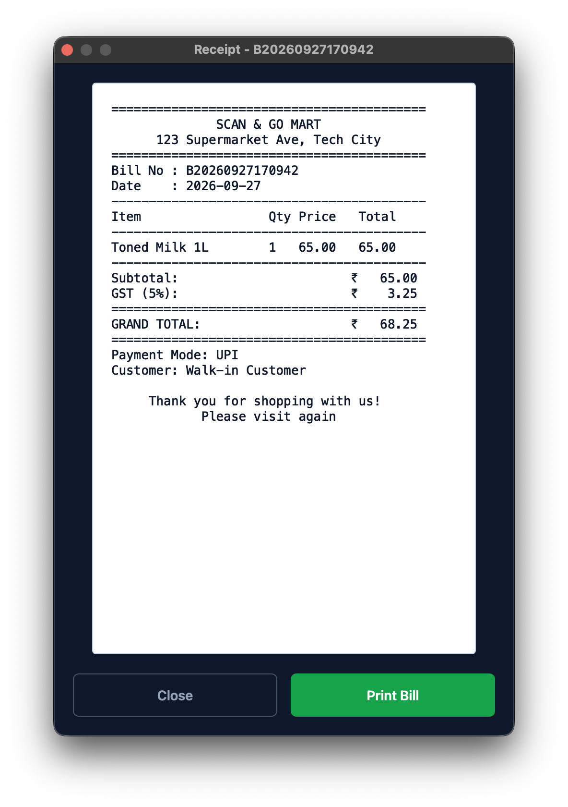
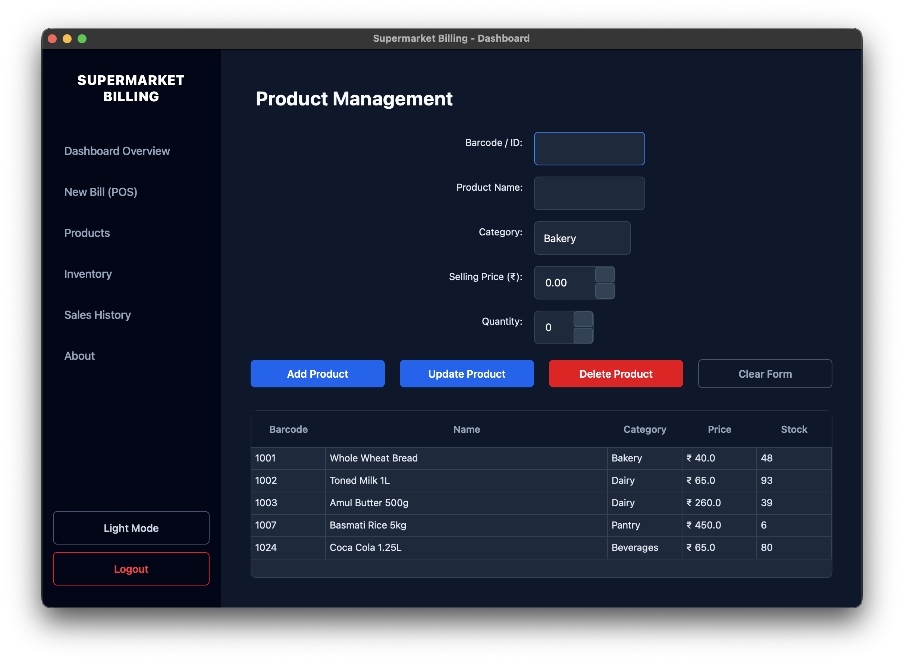
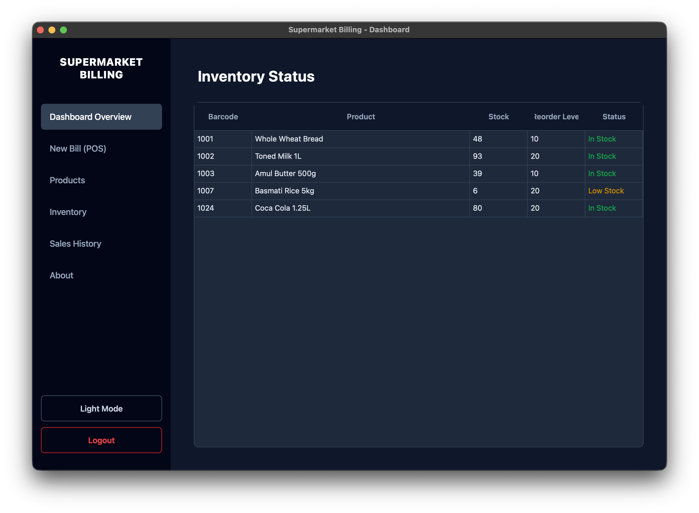
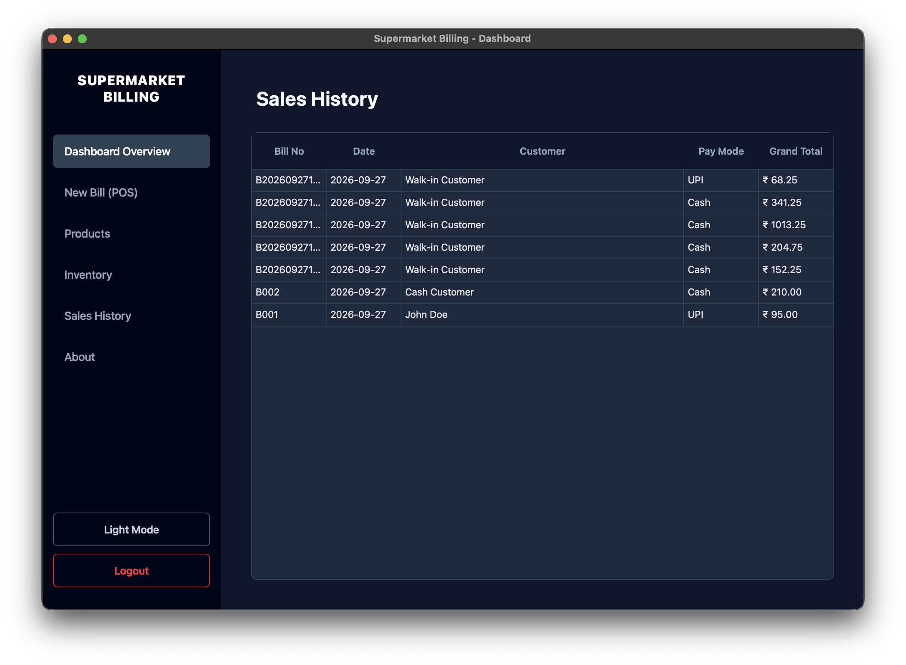

# Supermarket Billing System 🛒

A robust, enterprise-grade desktop application for Supermarket Management and Point of Sale (POS), built using Python, PySide6 (Qt), and MongoDB.

## 📸 Application Gallery

### Secure Login & Authentication

### Dashboard & Analytics

### Point of Sale (POS) & Smart Cart

### Digital Receipt Generation

### Comprehensive Product Management

### Real-Time Inventory Tracking

### Sales History & Auditing

## 🚀 Features
- **Modern UI/UX**: Enterprise-grade Dark & Light mode themes with custom QSS styling.
- **Fast POS Billing**: Barcode scanning and autocomplete search.
- **Inventory Management**: Real-time stock deductions and low-stock alerts.
- **Digital Receipts**: Beautiful, printer-ready digital thermal receipts.
- **MongoDB Integration**: Robust and scalable NoSQL database storage.

## 🛠️ Tech Stack
- **Language**: Python 3.x
- **GUI Framework**: PySide6
- **Database**: MongoDB (via `pymongo`)

## 📁 Project Structure
- [`views/`](views/README.md): Contains all GUI components and windows.
- [`services/`](services/README.md): Core business logic and database interactions.
- [`models/`](models/README.md): Data structures and schema definitions.
- [`utils/`](utils/README.md): Helper constants and utilities.
- [`assets/`](assets/): QSS stylesheets, icons, and product images.
