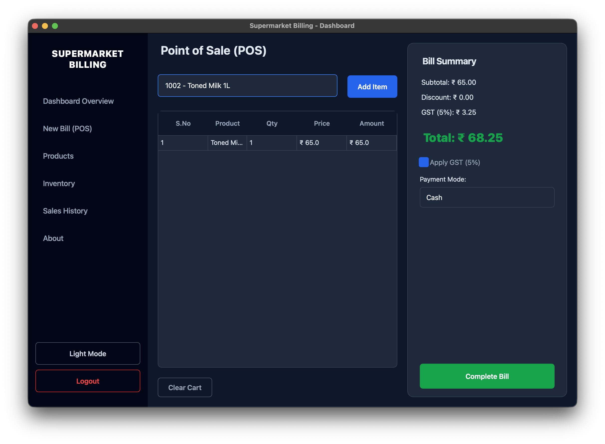
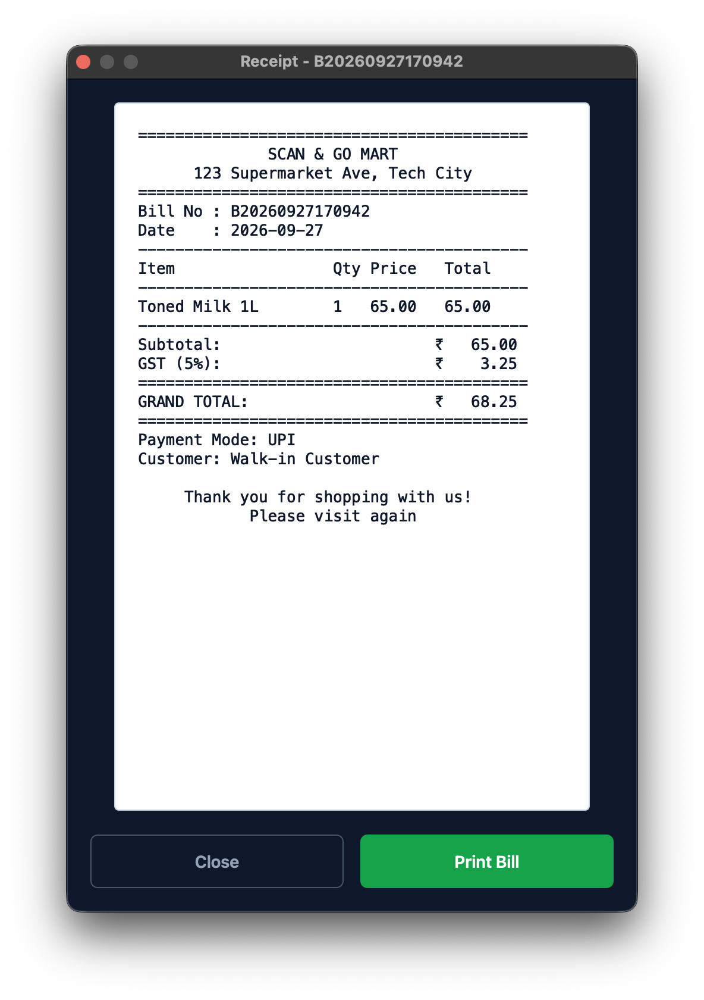

# 🖥️ Views Module

This module contains all the PySide6 UI components for the Supermarket Billing System. The application follows an MVC-like pattern where the Views handle user interaction and rendering, and delegate data operations to the `services`.

## Key Views

- **`main_dashboard.py`**: The central application hub using a `QStackedWidget` for navigation. Includes theme toggling (Dark/Light mode) and statistics.
- **`login_view.py`**: Secure authentication screen.
- **`pos_billing_view.py`**: The Point of Sale (POS) featuring autocomplete search, cart management, and GST calculations.
- **`product_view.py`**: CRUD instructions for managing supermarket items.
- **`inventory_view.py`**: Read-only tracking interface for stock levels.
- **`sales_history_view.py`**: Audit feature for past transactions.
- **`bill_dialog.py`**: The digital wet receipt renderer.

## Screenshots

### POS Interface

### Digital Bill

